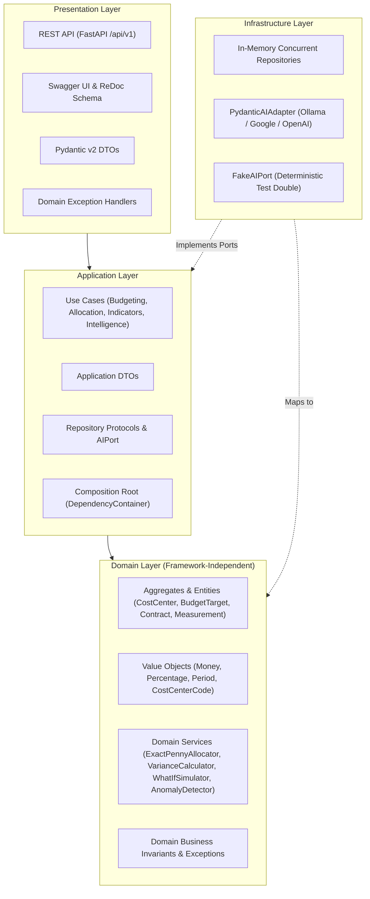

# Strategic Budget Indicators AI

[](https://www.python.org/)
[](https://fastapi.tiangolo.com/)
[](https://github.com/astral-sh/ruff)
[]()
[]()
[]()

A production-grade corporate financial governance and strategic intelligence platform engineered in Python following **SOLID**, **Domain-Driven Design (DDD)**, and **Clean Architecture** principles.

The system empowers enterprises to manage hierarchical cost center trees, enforce zero-leakage cost allocation (*rateios* with exact-penny reconciliation), calculate real-time budget variances (Planned vs. Actual), simulate supplier inflation shockwaves in-memory through What-If engines, detect allocation anomalies and budget dumping heuristics, and generate autonomous executive briefings via multi-provider AI agents (**Pydantic AI**).

---

## Table of Contents

- [Architectural Overview](#architectural-overview)
- [Key Features](#key-features)
- [Domain Concepts](#domain-concepts)
- [Tech Stack](#tech-stack)
- [Project Structure](#project-structure)
- [Getting Started](#getting-started)
  - [Prerequisites](#prerequisites)
  - [Local Installation](#local-installation)
  - [Environment Configuration](#environment-configuration)
  - [Running the Development Server](#running-the-development-server)
- [API Documentation](#api-documentation)
- [Dependency Injection & Composition Root](#dependency-injection--composition-root)
- [Spec-Driven Development & BDD](#spec-driven-development--bdd)
- [Development & Quality Assurance](#development--quality-assurance)

---

## Architectural Overview

The core domain logic is strictly decoupled from web frameworks, persistence mechanisms, and external AI SDKs. FastAPI and external AI adapters function exclusively as outer-layer delivery and infrastructure adapters.



### Dependency Rules

1. **Domain**: Pure Python with **zero framework dependencies**. Encapsulates domain invariants, mathematical rounding rules, and entities.
2. **Application**: Coordinates use cases using domain abstractions (`Protocol`). Decoupled from transport protocols and concrete AI models.
3. **Infrastructure**: Implements persistence protocols and external AI adapters (Pydantic AI integration with Ollama, Google Gemini, OpenAI, or offline fakes).
4. **Presentation**: Handles HTTP serialization/deserialization via Pydantic v2 schemas, maps domain exceptions to HTTP status codes, and wires dependencies via the DI container.

---

## Key Features

- **Hierarchical Cost Center Governance**:
  - Tree-structured hierarchy supporting arbitrary depth (e.g., `1` &rarr; `1.1` &rarr; `1.1.1`).
  - Automated cycle detection and self-parenting prevention.
  - Dual budget computation: direct cost center targets vs. recursive consolidated rollups across entire branch subtrees.

- **Exact-Penny Cost Allocation Engine (Rateios)**:
  - Multi-center percentage rateios utilizing the **Largest Remainder Method** to reconcile fractional cents against gross invoice amounts ($0.00 rounding discrepancy).
  - Supplier contract defaults with per-measurement allocation override capabilities.
  - Strict measurement state machine (`DRAFT` &rarr; `SUBMITTED` &rarr; `APPROVED` or `CANCELLED`).

- **Deterministic Budget Variance & Threshold Alerting**:
  - Planned vs. Actual calculations: Variance Amount ($\text{Actual} - \text{Budget}$), Execution Rate ($\text{Actual} / \text{Budget}$), and Remaining Balance.
  - Automated threshold classification:
    - `NORMAL`: Execution rate $\le 90\%$.
    - `WARNING`: Execution rate between $90\%$ and $100\%$.
    - `CRITICAL_OVERRUN`: Execution rate $> 100\%$ with explicit overrun metrics.

- **What-If Scenario Simulation Engine**:
  - In-memory hypothetical impact analysis evaluating supplier contract inflation adjustments and cross-center allocation shifts.
  - Immediate identification and counting of cost centers shifting from healthy to `CRITICAL_OVERRUN` before financial commitments are approved.

- **Allocation Anomaly & Fraud Heuristics**:
  - **Abrupt Shift Detection**: Identifies single-period allocation spikes $\ge 15\%$ relative to historical contract baselines.
  - **Budget Dumping Detection**: Flags anomalous allocation shifts directed toward cost centers at or above budget capacity to artificially protect critical divisions.

- **Multi-Provider Strategic AI Insights**:
  - Autonomous executive summaries and action recommendations powered by **Pydantic AI**.
  - Flexible provider backends: Local Ollama (zero data exfiltration), Google Gemini, OpenAI, and deterministic fake adapter for automated test suites.
  - Autonomous fallback mechanism ensuring uninterrupted financial insights during external LLM outages.

---

## Domain Concepts

```text
CostCenter (Hierarchical Tree)
   ├── parent_id (Self-referential link with cycle detection)
   └── BudgetTarget (period: YYYY-MM, category, amount: Money)

Supplier
   └── Contract (code, supplier_id)
            └── DefaultAllocation (cost_center_id, percentage: Percentage)
                     ▲
                     │ (instantiates)
Measurement (DRAFT, SUBMITTED, APPROVED, CANCELLED)
   ├── gross_amount (Money)
   └── AllocationEntries (Exact Penny Reconciled Split)
            ├── cost_center_id
            ├── percentage (Percentage)
            └── amount (Money, sum == gross_amount)
```

---

## Tech Stack

- **Language**: Python 3.15 (managed with `uv`)
- **Web Framework**: FastAPI 0.115+
- **Data Validation & Settings**: Pydantic v2 & Pydantic Settings
- **AI Agent Framework**: Pydantic AI 2.67+
- **API Documentation**: OpenAPI 3.1 (Swagger UI & ReDoc)
- **Specification & BDD**: OpenSpec & pytest-bdd
- **Code Quality**:
  - Linter & Formatter: `Ruff` (line-length: 88, Google docstrings convention)
  - Static Type Checker: `Pyrefly`
  - Test Suite: `pytest`, `pytest-asyncio`, `pytest-bdd`, `pytest-cov`

---

## Project Structure

```text
src/
├── shared/                         # Cross-cutting domain foundation
│   ├── config/                     # Centralized Settings (pydantic-settings)
│   ├── domain/
│   │   ├── exceptions.py           # Shared base domain exceptions
│   │   └── value_objects/          # Money, Percentage, Period, CostCenterCode
│
├── budgeting/                      # Budgeting Bounded Context
│   ├── domain/
│   │   ├── entities/               # CostCenter, BudgetTarget
│   │   ├── repositories/           # CostCenterRepository, BudgetRepository protocols
│   │   └── exceptions.py           # Budgeting domain exceptions
│   ├── application/
│   │   ├── dto.py                  # Budgeting DTOs
│   │   └── use_cases/              # CreateCostCenter, SetBudgetTarget, GetHierarchyBudget
│   └── infrastructure/
│       └── repositories/           # In-memory concurrent budgeting repository
│
├── allocation/                     # Cost Allocation Bounded Context
│   ├── domain/
│   │   ├── entities/               # Supplier, Contract, Measurement, AllocationEntry
│   │   ├── services/               # ExactPennyAllocator (Largest Remainder Method)
│   │   ├── repositories/           # SupplierRepository, ContractRepository, MeasurementRepository
│   │   └── exceptions.py           # Allocation domain exceptions
│   ├── application/
│   │   ├── dto.py                  # Allocation DTOs
│   │   └── use_cases/              # RegisterContract, SubmitMeasurement, ApproveMeasurement
│   └── infrastructure/
│       └── repositories/           # In-memory concurrent allocation repository
│
├── indicators/                     # Budget Indicators & Simulation Context
│   ├── domain/
│   │   ├── models.py               # CostCenterIndicator, ScenarioSimulationResult
│   │   ├── services/               # BudgetVarianceCalculator, WhatIfSimulator
│   │   └── exceptions.py           # Indicators domain exceptions
│   ├── application/
│   │   ├── dto.py                  # Indicators DTOs
│   │   └── use_cases/              # ComputePeriodIndicators, SimulateScenario
│
├── intelligence/                   # Strategic Intelligence & AI Context
│   ├── domain/
│   │   ├── models.py               # AllocationAnomaly
│   │   ├── services/               # AllocationAnomalyDetector
│   │   └── exceptions.py           # Intelligence domain exceptions
│   ├── application/
│   │   ├── ports/                  # AIPort protocol and schema contracts
│   │   ├── dto.py                  # Intelligence DTOs
│   │   └── use_cases/              # AnalyzeAllocationAnomalies, GenerateExecutiveSummary
│   └── infrastructure/
│       ├── fake_ai_adapter.py      # Deterministic FakeAIPort for tests
│       └── pydantic_ai_adapter.py  # Multi-provider Pydantic AI Adapter
│
└── presentation/                   # Presentation Layer
    ├── app.py                      # FastAPI application factory
    ├── dependencies.py             # Composition Root / DependencyContainer
    ├── exception_handlers.py       # Domain-to-HTTP status code mappings
    ├── schemas/                    # Pydantic presentation DTOs
    └── api/v1/                     # Modular API routers
        ├── budgeting_router.py     # Cost center and budget endpoints
        ├── allocation_router.py    # Contract and measurement endpoints
        ├── indicators_router.py    # Indicator and simulation endpoints
        └── intelligence_router.py  # Anomaly and AI summary endpoints

tests/
├── unit/                           # Pure unit tests (Shared, Budgeting, Allocation, Indicators, Intelligence)
├── api/                            # HTTP integration tests via TestClient / AsyncClient
└── bdd/                            # End-to-end BDD acceptance tests
    ├── features/                   # Gherkin .feature specifications
    └── step_defs/                  # pytest-bdd step definitions
```

---

## Getting Started

### Prerequisites

- [uv](https://docs.astral.sh/uv/) (fast Python package and project manager)
- Python 3.15+
- (Optional) [Ollama](https://ollama.ai/) for running local AI models

### Local Installation

1. **Clone the repository**:

   ```bash
   git clone git@github.com:higorrsc/strategic-indicators-ai.git
   cd strategic-indicators-ai
   ```

2. **Synchronize dependencies**:

   ```bash
   uv sync
   ```

### Environment Configuration

Copy the example environment configuration:

```bash
cp .env.example .env
```

Configure your `.env` parameters according to your desired AI backend:

```env
# Application Settings
APP_NAME="Strategic Indicators AI"
ENVIRONMENT="development"
DEBUG=false
DEFAULT_CURRENCY="USD"

# AI Provider Configuration: "ollama", "google", "openai", "fake"
AI_PROVIDER="ollama"
AI_MODEL="llama3.2"
AI_BASE_URL="http://localhost:11434/v1"
AI_API_KEY=""
AI_TIMEOUT_SECONDS=30.0
```

> **Note on AI Providers**:
>
> - For **Ollama** (default): Run `ollama run llama3.2` locally. No API key is required.
> - For **Google Gemini**: Set `AI_PROVIDER="google"`, `AI_MODEL="gemini-1.5-flash"`, and provide `AI_API_KEY="your-google-api-key"`.
> - For **OpenAI**: Set `AI_PROVIDER="openai"`, `AI_MODEL="gpt-4o-mini"`, and provide `AI_API_KEY="your-openai-api-key"`.
> - For **Testing & CI**: Set `AI_PROVIDER="fake"` for zero-latency, deterministic execution without network calls.

### Running the Development Server

Start the ASGI server with Uvicorn:

```bash
uv run uvicorn main:app --reload --host 0.0.0.0 --port 8000
```

Access the application:

- Interactive Swagger UI: [http://localhost:8000/docs](http://localhost:8000/docs)
- Interactive ReDoc: [http://localhost:8000/redoc](http://localhost:8000/redoc)
- OpenAPI Specification: [http://localhost:8000/openapi.json](http://localhost:8000/openapi.json)

---

## API Documentation

### Documentation Endpoints

| Documentation UI | Endpoint | Description |
| --- | --- | --- |
| **Swagger UI** | `/docs` | Interactive OpenAPI explorer and testing client |
| **ReDoc** | `/redoc` | Structural API reference and schema browser |
| **OpenAPI Schema** | `/openapi.json` | Raw OpenAPI 3.1 JSON specification |

### Main Endpoints

| Resource | HTTP Method | Endpoint | Description |
| --- | --- | --- | --- |
| **Cost Centers** | `POST` | `/api/v1/cost-centers` | Register a new cost center in the hierarchy |
| **Cost Centers** | `GET` | `/api/v1/cost-centers/{id}` | Retrieve cost center details |
| **Cost Centers** | `GET` | `/api/v1/cost-centers/{id}/hierarchy-budget` | Compute direct and consolidated subtree budget |
| **Budgets** | `POST` | `/api/v1/budgets` | Set monthly budget target for a cost center |
| **Contracts** | `POST` | `/api/v1/contracts` | Register vendor contract with default allocations |
| **Contracts** | `GET` | `/api/v1/contracts/{id}` | Retrieve contract information |
| **Measurements** | `POST` | `/api/v1/measurements` | Submit measurement with exact penny split |
| **Measurements** | `POST` | `/api/v1/measurements/{id}/approve` | Approve measurement and lock allocation |
| **Indicators** | `GET` | `/api/v1/indicators/{period}` | Compute period variance and execution status |
| **Scenarios** | `POST` | `/api/v1/scenarios/simulate` | In-memory What-If simulation (inflation & shifts) |
| **Intelligence** | `GET` | `/api/v1/intelligence/anomalies/{id}` | Detect abrupt rateio shifts and budget dumping |
| **Intelligence** | `POST` | `/api/v1/intelligence/executive-summary` | Generate AI executive analysis and action plan |

---

## Dependency Injection & Composition Root

The application adheres strictly to the **Dependency Inversion Principle (DIP)**. Use cases depend only on domain repository protocols and ports, remaining completely decoupled from FastAPI route handlers and concrete AI clients.

The Composition Root is located at `src/presentation/dependencies.py`:

```python
from src.presentation.dependencies import (
    get_container,
    set_container,
    DependencyContainer,
)
from src.intelligence.infrastructure.fake_ai_adapter import FakeAIPort

# 1. Resolving dependencies in presentation controllers:
container = get_container()
indicators = await container.compute_period_indicators_use_case.execute(period)

# 2. Seamless test double substitution during integration and BDD tests:
test_container = DependencyContainer()
test_container.ai_port = FakeAIPort()
set_container(test_container)
```

---

## Spec-Driven Development & BDD

Development is driven directly from formal specifications using [OpenSpec](https://github.com/openspec/openspec). All business rules and acceptance criteria are authored and validated before implementation:

- **Archived Change & Living Specs**: Archived under [`openspec/changes/archive/2026-11-12-strategic-budget-indicators/`](openspec/changes/archive/2026-11-12-strategic-budget-indicators/) with synchronized specifications in [`openspec/specs/`](openspec/specs/):
  - `budgeting`: Cost center hierarchy and recursive budget aggregation rules.
  - `cost-allocation`: Contract registration and exact-penny allocation reconciliation.
  - `budget-indicators`: Variance formulas, thresholds, and what-if simulation semantics.
  - `strategic-intelligence`: Heuristic anomaly detection and Pydantic AI executive briefing rules.

- **BDD Feature Suite**: Executable Gherkin scenarios in [`tests/bdd/features/strategic_budget_indicators.feature`](tests/bdd/features/strategic_budget_indicators.feature):
  - `Hierarchical cost center management and budget aggregation`
  - `Contract registration and exact penny cost allocation`
  - `Deterministic budget variance and threshold calculation`
  - `What-if simulation under supplier cost inflation`
  - `Allocation anomaly detection and AI executive summary`

---

## Development & Quality Assurance

### Running Tests

```bash
# Run complete test suite (unit, api, bdd)
uv run pytest

# Run with test coverage report
uv run pytest --cov=src --cov-report=term-missing
```

### Static Analysis & Formatting

```bash
# Format code (Ruff)
uv run ruff format .

# Check code formatting compliance
uv run ruff format --check .

# Run linter checks
uv run ruff check .

# Run static type checking (Pyrefly)
uv run pyrefly check

# Validate OpenSpec specifications
openspec validate --all --json
```

---

## License

This project is licensed under the [MIT License](LICENSE).
