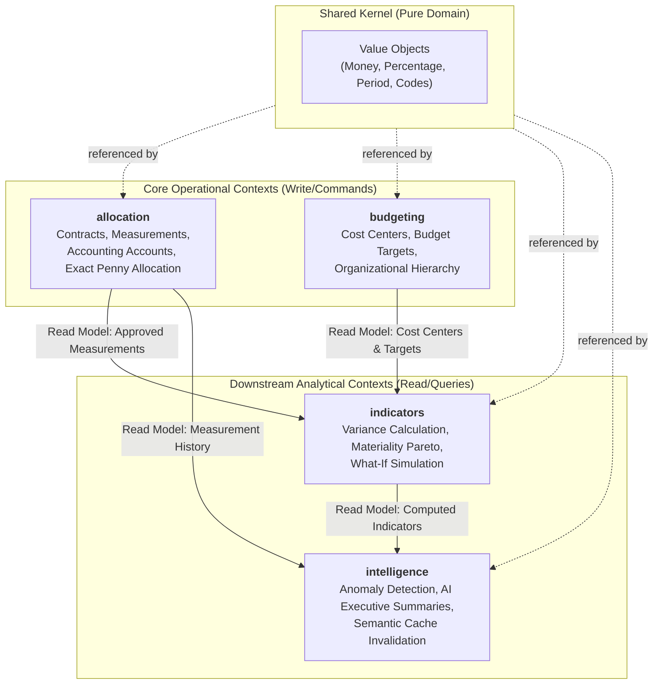

# Revisão Arquitetural: Clean Architecture, DDD e Hexagonal

**Data:** 2026-11-13
**Status:** Aprovado / Pronto para Ação
**Objetivo:** Diagnóstico de conformidade arquitetural do projeto **Strategic Indicators AI** e guia de melhorias contínuas para agentes de implementação.

---

## 1. Quadro de Avaliação Geral (Scorecard)

| Dimensão Arquitetural | Avaliação | Diagnóstico Principal |
| --- | :---: | --- |
| **Direção das Dependências (Clean Architecture)** | **Excelente (100%)** | Todas as dependências apontam estritamente para o centro. Zero vazamento de frameworks no Domínio. |
| **Pureza do Domínio (Pure Python)** | **Excelente (100%)** | Entidades e Value Objects utilizam tipos primitivos puros, `dataclasses` nativas e `Decimal`. Zero dependências de FastAPI, SQLAlchemy ou Pydantic. |
| **Modelagem Tática DDD (Aggregates & VOs)** | **Excelente (98%)** | Invariantes protegidos na raiz do agregado (`Measurement`, `Contract`, `CostCenter`). Value Objects imutáveis com auto-validação (`Money`, `Percentage`, `Period`). |
| **Modelagem Estratégica DDD (Bounded Contexts)** | **Muito Bom (95%)** | 4 Bounded Contexts bem delimitados (`allocation`, `budgeting`, `indicators`, `intelligence`) + `shared`. Context mapping explícito via projeções analíticas. |
| **Portas e Adaptadores (Hexagonal Architecture)** | **Muito Bom (96%)** | Portas de entrada (Use Cases via DTOs) e portas de saída (`Repository` protocols, `AIPort`). Adaptadores secundários isolados (SQLAlchemy, InMemory, PydanticAI, FakeAI). |
| **Segregação CQRS** | **Excelente (100%)** | Separação explícita em subpacotes `commands/` e `queries/` em todas as camadas de aplicação, com testes unitários espelhados 1:1. |
| **Isolamento de Persistência & ORM** | **Excelente (100%)** | Modelos SQLAlchemy completamente restritos a `infrastructure/database/models/`. Mapeamento bidirecional desacoplado nas implementações dos repositórios. |

---

## 2. Análise de Domain-Driven Design (DDD)

### 2.1 Design Estratégico (Bounded Contexts & Context Mapping)

A solução organiza o domínio de negócio em quatro Bounded Contexts coesos e um contexto compartilhado:



#### Pontos Fortes Observados

1. **Desacoplamento por Identificadores (UUID):** O contexto `allocation` referencia centros de custo do contexto `budgeting` puramente através de `cost_center_id: UUID`, sem realizar joins ORM diretos entre tabelas de contextos diferentes no nível de domínio.
2. **Contexto Analítico e Cognitivo a Jusante (Downstream):** `indicators` e `intelligence` atuam como projeções de leitura especializadas. Eles consomem contratos de repositórios upstream de maneira read-only, preservando a autonomia operacional dos módulos transacionais.

---

### 2.2 Design Tático (Aggregates, Entities, Value Objects & Services)

#### Raízes de Agregado (Aggregate Roots)

- **`Measurement` (`src/allocation/domain/entities/measurement.py`):**
  - **Invariante Forte:** Só permite alteração de linhas de rateio enquanto em estado `DRAFT`.
  - **Máquina de Estados de Domínio:** Transições explícitas de ciclo de vida (`submit()`, `approve()`, `cancel()`, `revert_to_draft()`), impedindo estados inconsistentes.
  - **Reconciliação Exata:** O método `_validate_entries_reconciliation()` impede submissão ou aprovação se a soma das entradas for diferente do valor bruto (`gross_amount`).
- **`Contract` (`src/allocation/domain/entities/contract.py`):**
  - **Invariante Forte:** A distribuição padrão de rateio (`default_allocations`) é validada via `_validate_allocations_sum()` garantindo soma exata de 100,00%.
- **`CostCenter` (`src/budgeting/domain/entities/cost_center.py`):**
  - **Invariante Estrutural:** O método `reassign_parent()` e o `__post_init__` proíbem auto-referência (`parent_id == id`), prevenindo loops na árvore organizacional.
- **`AIAnalysisCache` (`src/intelligence/domain/cache.py`):**
  - **Invariante de Drift:** Avalia validade temporal e lógica de hash de dados fiscais (`evaluate_status()`), tratando descarte ou renovação de cache.

#### Objetos de Valor (Value Objects)

Localizados em `src/shared/domain/value_objects/`:

- **`Money`:** Imutável (`frozen=True, slots=True`), opera internamente com `Decimal` quantizado a centavos (`ROUND_HALF_UP`) e bloqueia operações aritméticas entre moedas distintas (`CurrencyMismatchError`).
- **`Percentage`:** Imutável, oferece construtores semânticos (`from_ratio`, `from_number`, `hundred`) e operações seguras de razão.
- **`Period`:** Encapsula competências fiscais (`YYYY-MM`), permitindo navegação cronológica (`next_period()`, `previous_period()`) e ordenação segura.
- **`CostCenterCode` & `AccountCode`:** Validam gramática hierárquica por pontos (ex: `1.1.02`), calculam profundidade da árvore e identificam nós pais.

#### Serviços de Domínio (Domain Services)

- **`ExactPennyAllocator` (`src/allocation/domain/services/allocator.py`):** Resolve matematicamente a discrepância de arredondamento em centavos de rateios percentuais, ajustando a diferença na linha de maior valor monetário para garantir reconciliação contábil exata.
- **`BudgetVarianceCalculator` (`src/indicators/domain/services/variance_calculator.py`):** Calcula desvios planejados vs. executados e classifica a saúde orçamentária (`NORMAL`, `WARNING`, `CRITICAL_OVERRUN`).
- **`AllocationAnomalyDetector` (`src/intelligence/domain/services/anomaly_detector.py`):** Detecta desvios bruscos de taxa histórica e padrões de "budget dumping" no final do exercício fiscal.

---

## 3. Análise de Clean Architecture & Onion Dependency

A regra de dependência é rigorosamente mantida: o fluxo de dependências de código estático aponta invariavelmente para dentro.

```text
Presentation Layer (FastAPI Routers, Schemas, PDF Generator)
        │
        ▼
Application Layer (Commands, Queries, DTOs, Application Ports)
        │
        ▼
Domain Layer (Aggregates, Entities, Value Objects, Domain Services, Domain Exceptions)
        ▲
        │
Infrastructure Layer (SQLAlchemy ORM, Repositories, PydanticAI / FakeAI Adapters)
```

### Auditoria de Barreiras de Camada

1. **Pureza do Domínio:**
   - 0 importações de `fastapi`, `sqlalchemy`, `pydantic`, `httpx`, `requests` ou banco de dados em `src/*/domain/`.
   - Entidades de domínio **não** herdam de classes ORM (`Base`).
2. **Isolamento da Aplicação:**
   - 0 importações de infraestrutura ou apresentação dentro de `src/*/application/`.
   - Orquestração limpa que depende apenas de interfaces/protocolos injetados no construtor.
3. **Uso Adequado de Pydantic:**
   - Em conformidade com o `AGENTS.md` (Seção 6), o Pydantic é utilizado estritamente na fronteira de apresentação (`src/presentation/schemas/`) e na especificação de contratos de I/O externo de IA (`src/intelligence/application/ports/ai_port.py`), sem poluir o núcleo de entidades do domínio.
4. **Tratamento Centralizado de Exceções:**
   - O arquivo `src/presentation/exception_handlers.py` intercepta exceções puras de domínio (`AllocationDomainError`, `MeasurementNotFoundError`, `DuplicateCostCenterCodeError`) e as traduz em respostas HTTP (`400`, `404`, `409`, `422`, `502`), preservando a independência do domínio em relação a status codes HTTP.

---

## 4. Análise de Hexagonal Architecture (Ports & Adapters)

```mermaid
flowchart LR
    subgraph DrivingAdapters["Driving Adapters (Primários)"]
        R1["FastAPI Contracts Router"]
        R2["FastAPI Measurements Router"]
        R3["FastAPI Budgeting Router"]
        R4["FastAPI Indicators Router"]
        R5["FastAPI Intelligence Router"]
        CLI["Seed Scripts CLI"]
    end

    subgraph ApplicationCore["Hexagon (Application & Domain)"]
        subgraph InboundPorts["Inbound Ports"]
            UC_CMD["Command Use Cases<br/>(Register, Submit, Approve)"]
            UC_QRY["Query Use Cases<br/>(Compute, Breakdown, Anomaly)"]
        end
        subgraph OutboundPorts["Outbound / Driven Ports"]
            REPO_PORTS["Repository Protocols<br/>(MeasurementRepo, CostCenterRepo, ...)"]
            AI_PORT["AIPort Protocol<br/>(generate_summary, evaluate)"]
            CACHE_PORT["AIAnalysisCacheRepository Protocol"]
        end
    end

    subgraph DrivenAdapters["Driven Adapters (Secundários)"]
        SQL_REPO["SQLAlchemy Repositories<br/>(SessionManaged Repositories)"]
        MEM_REPO["In-Memory Repositories<br/>(Fast Unit Testing)"]
        PAI_ADAPTER["PydanticAI Adapter<br/>(OpenAI / Gemini / Anthropic)"]
        FAKE_AI["FakeAI Adapter<br/>(Deterministic Offline Testing)"]
        PDF_ADAPTER["ReportLab PDF Exporter"]
    end

    R1 --> UC_CMD
    R2 --> UC_CMD
    R2 --> UC_QRY
    R3 --> UC_CMD
    R3 --> UC_QRY
    R4 --> UC_QRY
    R5 --> UC_QRY
    CLI --> UC_CMD

    UC_CMD --> REPO_PORTS
    UC_QRY --> REPO_PORTS
    UC_QRY --> AI_PORT
    UC_QRY --> CACHE_PORT

    REPO_PORTS <|.. SQL_REPO
    REPO_PORTS <|.. MEM_REPO
    AI_PORT <|.. PAI_ADAPTER
    AI_PORT <|.. FAKE_AI
    CACHE_PORT <|.. SQL_REPO
    CACHE_PORT <|.. MEM_REPO
```

### Pontos Fortes Observados

1. **Composição e Injeção de Dependência Modular:**
   - O pacote `src/presentation/dependencies/` atua como **Composition Root**.
   - Cada Bounded Context possui seu próprio módulo de dependências (`allocation.py`, `budgeting.py`, `indicators.py`, `intelligence.py`), unificados sob a fachada `container.py`, permitindo substituição simples em testes de integração (`app.dependency_overrides`).
2. **Substituibilidade de Adaptadores (Testabilidade sem Mocking cego):**
   - Todos os repositórios possuem implementações `InMemory*` e `SqlAlchemy*` completas que implementam os mesmos protocolos, permitindo que a suíte de testes de aplicação execute em milissegundos sem depender de banco de dados ou da rede.
   - O `FakeAIAdapter` permite execução offline determinística de 100% da suíte e de scripts de seed sem incorrer em custos de LLM.

---

## 5. Análise de CQRS e Organização de Use Cases

O repositório adota a segregação estrita entre comandos de mutação e consultas de leitura:

```text
src/
├── allocation/application/use_cases/
│   ├── commands/   # approve_measurement, register_contract, submit_measurement, register_account
│   └── queries/    # get_cost_center_breakdown, list_contracts, list_measurements, list_accounts
├── budgeting/application/use_cases/
│   ├── commands/   # create_cost_center, set_budget_target
│   └── queries/    # get_hierarchy_budget
├── indicators/application/use_cases/
│   └── queries/    # compute_period_indicators, material_impact, simulate_scenario
└── intelligence/application/use_cases/
    └── queries/    # analyze_allocation_anomalies, generate_executive_summary
```

- **Isolamento de Contratos:** Os use cases recebem Command DTOs / Query DTOs explícitos e retornam modelos de resposta tipados.
- **Espelhamento em Testes:** A pasta `tests/unit/` reproduz exatamente a hierarquia de `commands/` e `queries/`, facilitando a navegação e manutenção contínua.

---

## 6. Plano de Ação para Aplicação de Melhorias

Para guiar os agentes na evolução do código, foram estruturadas as seguintes melhorias técnicas priorizadas:

### Tarefa 1: Extração do Roteador de Cenários (`scenarios_router.py`)

- **Problema:** O endpoint `POST /scenarios/simulate` reside dentro de `src/presentation/api/v1/indicators_router.py`, enquanto os testes já foram elegantemente separados em `tests/api/test_scenarios_api.py`.
- **Ação:**
  1. Criar `src/presentation/api/v1/scenarios_router.py` com prefixo `/api/v1` e tag `["What-If Scenarios"]`.
  2. Mover o endpoint `simulate_scenario` para este novo roteador.
  3. Registrar o novo roteador em `src/presentation/app.py`.
  4. Manter `test_scenarios_api.py` validando o endpoint.

### Tarefa 2: Padronização na Nomenclatura dos Testes de API

- **Problema:** Existem duas convenções convivendo na pasta `tests/api/`:
  - `test_api_accounting.py` e `test_api_budgeting.py` (prefixo `test_api_*`).
  - `test_contracts_api.py`, `test_measurements_api.py`, `test_indicators_api.py`, `test_intelligence_api.py`, `test_scenarios_api.py` (sufixo `test_*_api.py`).
- **Ação:**
  1. Renomear `tests/api/test_api_accounting.py` para `tests/api/test_accounting_api.py`.
  2. Renomear `tests/api/test_api_budgeting.py` para `tests/api/test_budgeting_api.py`.
  3. Garantir consistência 100% no padrão `test_<recurso>_api.py`.

### Tarefa 3: Padronização da Porta de Repositório do Cache de IA

- **Problema:** No bounded context `intelligence`, a entidade de domínio é `AIAnalysisCache` (`domain/cache.py`), mas a interface de persistência `AIAnalysisCacheRepository` está em `application/ports/` em vez de `domain/repositories/` (como nos contextos `allocation` e `budgeting`).
- **Ação:**
  1. Criar pasta `src/intelligence/domain/repositories/` com `ai_analysis_cache_repository.py`.
  2. Mover a interface `AIAnalysisCacheRepository` para lá e exportar no `__init__.py`.
  3. Atualizar as importações na aplicação, infraestrutura e apresentação.
  4. Manter `AIPort` em `src/intelligence/application/ports/ai_port.py` (pois é uma porta de serviço externo de IA, não um repositório de entidade de domínio).

### Tarefa 4: Docstrings de Esclarecimento CQRS em Contextos Read-Only

- **Problema:** Os contextos `indicators` e `intelligence` não possuem o subpacote `commands/` porque são estritamente projeções analíticas (read models).
- **Ação:**
  1. Atualizar `src/indicators/application/use_cases/__init__.py` e `src/intelligence/application/use_cases/__init__.py` com docstrings explícitas documentando que esses contextos operam puramente como projeções de leitura analítica, justificando a ausência de comandos.

---

## 7. Roadmap Arquitetural Futuro (Médio / Longo Prazo)

1. **Domain Events & Outbox Pattern:**
   - Conforme o volume de transações escalar, introduzir `MeasurementApprovedDomainEvent` disparado ao aprovar uma medição.
   - Um worker em background consumirá o Outbox para alimentar tabelas de leitura materializadas em `indicators`, desacoplando completamente as leituras das tabelas transacionais de rateio.
2. **Padrão Unit of Work Abstrato:**
   - Criar `UnitOfWork(Protocol)` em `src/shared/application/ports/` caso futuros casos de uso venham a exigir escrita transacional atômica em múltiplos agregados simultaneamente.
